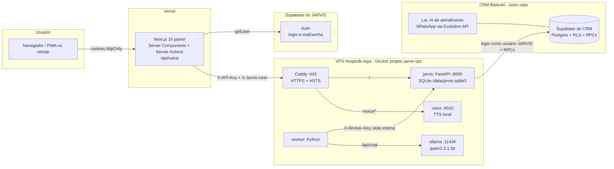
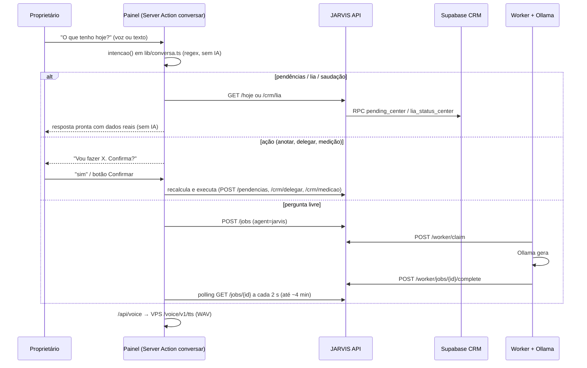
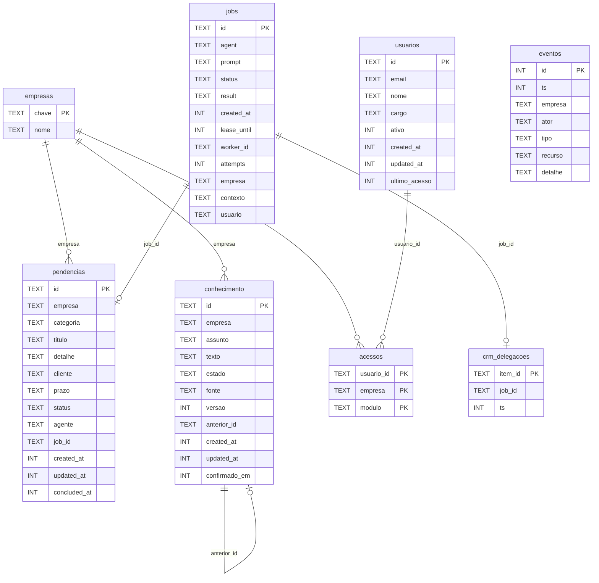
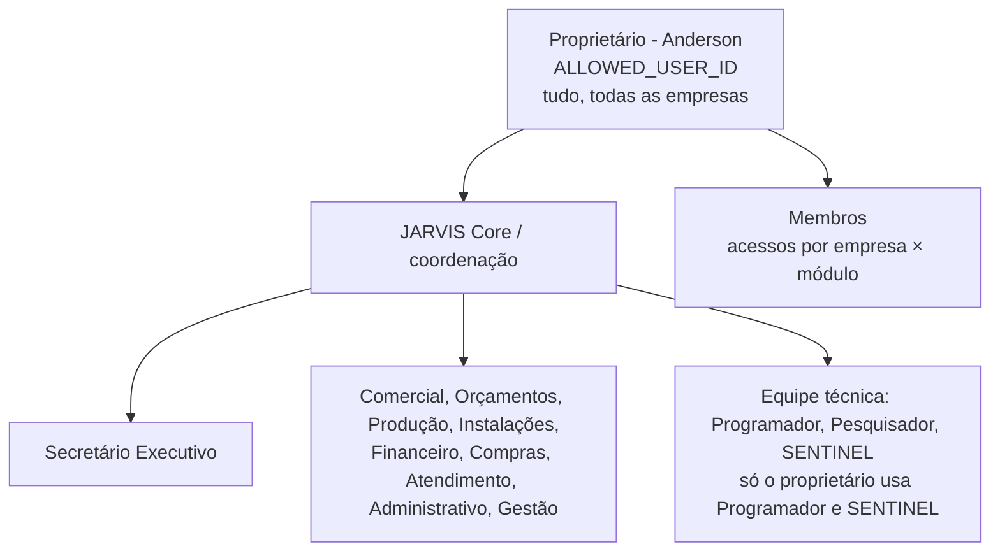

# CONTEXTO COMPLETO DO PROJETO — JARVIS AI CRM Bielenki

> Documento de transferência de contexto entre IAs. Gerado em **19/11/2026** a partir do código real do repositório
> `anderrsc/JARVIS-AI-CRM-Bielenki` (branch `main`, commit `c17c083`), do PR #14 (aberto), dos documentos de handoff da
> pasta local do proprietário e do histórico de conversas do projeto.
>
> **Convenção de confiabilidade usada em todo o documento**
> - **[VERIFICADO]**: conferido no código, rodando testes ou em registro do GitHub nesta auditoria.
> - **[RELATADO]**: dito em conversas, handoffs ou PRs anteriores; não reconferido agora.
> - **[HIPÓTESE]**: dedução provável, sem prova.
>
> Nenhum segredo, senha, token, chave, IP de servidor ou dado pessoal de cliente foi incluído. O repositório é público:
> mantenha assim.

---

## Sumário

1. [Resumo executivo](#1-resumo-executivo)
2. [Contexto geral e objetivos](#2-contexto-geral-e-objetivos)
3. [Arquitetura e tecnologias](#3-arquitetura-e-tecnologias)
4. [Estrutura de arquivos](#4-estrutura-de-arquivos)
5. [Banco de dados](#5-banco-de-dados)
6. [Módulos e funcionalidades](#6-módulos-e-funcionalidades)
7. [APIs e integrações](#7-apis-e-integrações)
8. [Regras de negócio](#8-regras-de-negócio)
9. [Usuários e permissões](#9-usuários-e-permissões)
10. [Inteligência artificial e automações](#10-inteligência-artificial-e-automações)
11. [Interface e experiência do usuário](#11-interface-e-experiência-do-usuário)
12. [Histórico de desenvolvimento](#12-histórico-de-desenvolvimento)
13. [Bugs e problemas conhecidos](#13-bugs-e-problemas-conhecidos)
14. [Funcionalidades pendentes](#14-funcionalidades-pendentes)
15. [Segurança e infraestrutura](#15-segurança-e-infraestrutura)
16. [Roadmap priorizado](#16-roadmap-priorizado)
17. [Instruções de instalação e deploy](#17-instruções-de-instalação-e-deploy)
18. [LEIA ISTO ANTES DE CONTINUAR O DESENVOLVIMENTO](#18-leia-isto-antes-de-continuar-o-desenvolvimento)
19. [Glossário e informações adicionais](#19-glossário-e-informações-adicionais)
20. [Checklist de continuidade](#20-checklist-de-continuidade)

---

## 1. Resumo executivo

**JARVIS** é um assessor executivo de IA (inspirado no JARVIS do Homem de Ferro) para o proprietário **Anderson**, dono de
duas empresas: **Marquinhos Calhas e Esquadrias** e **Bielenki Metal**. A ideia central é uma *equipe de funcionários
digitais* (14 agentes) que ajuda no dia a dia: pendências, cobranças, medições, instalações, atendimento, planejamento.
Desde 19/11/2026 ele também deve ser o **assistente pessoal** do Anderson. **Foco atual: só a Marquinhos.**

O JARVIS **não é o CRM**. O CRM da Marquinhos ("CRM Bielenki") é outro sistema, em outro repositório
(`anderrsc/crm-bielenki`, Next.js 15 + Supabase), **inacessível nesta auditoria**. O JARVIS lê e escreve nele apenas por RPCs
próprias, com um usuário de menor privilégio.

| Componente | Tecnologia | Onde roda | Estado |
|---|---|---|---|
| Painel web (`web/`) | Next.js 16.4.5, React 19.3, Supabase Auth | Vercel: `https://jarvis-ai-crm-bielenki.vercel.app` | No ar [RELATADO]; build ok [VERIFICADO] |
| API (`cloud/`) | FastAPI + SQLite | VPS (Hospede Aqui), Docker, atrás do Caddy em `https://jarvis-bielenki.duckdns.org` | No ar [RELATADO]; 33 testes ok [VERIFICADO] |
| Worker (`worker/`) | Python + httpx | VPS, Docker | No ar [RELATADO] |
| LLM local | Ollama `qwen2.5:1.5b` (CPU, contexto 2048) | VPS, Docker | No ar [RELATADO] |
| Voz (`voice/`) | **main:** Chatterbox (clone de referência). **PR #14:** Kokoro `pm_alex` | VPS, Docker, `/voice/*` no Caddy | main implantada [RELATADO]; PR #14 **não mergeado** [VERIFICADO] |
| CRM Bielenki | Next.js 15 + Supabase (RLS) | Vercel `crm-bielenki.vercel.app` | Fora deste repo |

**Estágio**: MVP funcional em uso. Fases 1 (utilidade), 2 (conhecimento), 3 (permissões) feitas; fase 4 (integrações)
parcial: leitura do CRM, Lia (atendimento), agendamento de medição. Escritório 3D em CSS existe. Pendências críticas:
VPS possivelmente desatualizada (PRs #11–#13), PR #14 da voz aguardando merge, backup do SQLite inexistente, lint
quebrado na `main`.

---

## 2. Contexto geral e objetivos

### 2.1 Propósito e problema

O proprietário perde tempo juntando informações espalhadas (CRM, WhatsApp, financeiro) e decidindo prioridades. O JARVIS:
- responde "o que temos para hoje?" com dados **reais** do CRM, priorizados;
- delega pendências a agentes especializados que preparam próximas ações (rascunhos, planos);
- executa ações reais **somente com confirmação** (anotar pendência, delegar, agendar medição no CRM);
- conversa por voz em pt-BR (celular e computador).

Pergunta-guia da diretriz do proprietário: *"Quais tarefas esse funcionário digital consegue realmente executar para
economizar meu tempo hoje?"*

### 2.2 Público e perfis

| Perfil | Quem | Situação |
|---|---|---|
| Proprietário / superadministrador | Anderson (UUID em `ALLOWED_USER_ID`) | ✅ Único usuário real hoje [RELATADO] |
| Membros (funcionários) | Cadastrados pelo proprietário com acesso por empresa e módulo | ✅ Implementado; ❓ nenhum membro real confirmado |
| Usuário técnico "JARVIS" no CRM | Conta própria no CRM, cargo **atendente** | ✅ Ativo [RELATADO] |

### 2.3 Objetivos (ordem oficial de prioridade, definida pelo proprietário em 16/11/2026)

1. **Utilidade empresarial** (funcionários digitais úteis no dia a dia).
2. **Cérebro central e memória** (procedimentos, regras, contexto).
3. **Multiempresa e permissões** (separação rigorosa Marquinhos × Bielenki Metal).
4. **Integrações e automações** (CRM, agenda, e-mail, WhatsApp, rotinas).
5. **Escritório virtual 3D** (agentes com estado real).
6. **Equipe de programação** (agentes técnicos).

Atualização de 19/11/2026: JARVIS também será **assistente pessoal** do Anderson; **escopo só Marquinhos** "para não fazer
muita coisa de uma vez". OpenJarvis (open-jarvis/OpenJarvis) avaliado e **não adotado** como base.

### 2.4 Empresas

| Chave interna | Nome | Ramo | Fonte de dados | Integração |
|---|---|---|---|---|
| `marquinhos` | Marquinhos Calhas e Esquadrias | Calhas, rufos, pingadeiras, condutores, esquadrias de alumínio, vidros, instalações | **CRM Bielenki** | ✅ Leitura + agenda |
| `bielenki` | Bielenki Metal | Processos próprios (não presumir iguais aos da Marquinhos) | **ERP Bielenki** | ❌ Nenhuma (fora do foco) |

### 2.5 Visão de longo prazo (dos prompts do proprietário, não implementado salvo indicação)

"JARVIS AI OFFICE": cérebro central modular (raciocínio, memória, execução, supervisão, conhecimento, comunicação) com
modelos locais e APIs externas conforme a complexidade; memória tipada (pessoal, empresarial, operacional, projetos,
decisões); escritório 3D com agentes trabalhando e reuniões virtuais; rotina matinal; integração com agenda, e-mail,
WhatsApp, ERP da Bielenki Metal; equipe técnica (arquiteto, full-stack, banco, integrações, auditor, testes, designer,
infraestrutura) para projetos e para o CRM; identidade visual por empresa nos documentos.

Textos originais completos ficam no histórico do projeto (mensagens "DIRETRIZ PRINCIPAL", "PROMPT MASTER DEFINITIVO —
JARVIS AI OFFICE", "PROMPT — EVOLUÇÃO DO JARVIS", "PROMPT MESTRE — REESTRUTURAÇÃO COMPLETA DO ATENDIMENTO"). O plano
unificado está em `docs/PLANO_ESCRITORIO.md`.

---

## 3. Arquitetura e tecnologias

### 3.1 Diagrama de componentes



### 3.2 Fluxo de uma pergunta na conversa



### 3.3 Linguagens, frameworks e versões [VERIFICADO em arquivos]

| Camada | Itens |
|---|---|
| Backend | Python 3.12 (imagem `python:3.12-slim`), `fastapi>=0.115,<1`, `uvicorn>=0.30,<1` (`cloud/requirements.txt`) |
| Worker | Python 3.12, `httpx>=0.27,<1` |
| Testes backend | `pytest>=8,<10` (`requirements-dev.txt`) |
| Painel | `next 16.4.5`, `react 19.3.0`, `react-dom 19.3.0`, `@supabase/ssr ^0.12.7`, `@supabase/supabase-js ^2.119.0`, TypeScript 5, ESLint 9 + `eslint-config-next 16.4.5`; testes com `node --test --experimental-strip-types` |
| Voz (main) | `chatterbox-tts==0.1.7`, `torch==2.6.0` CPU, `fastapi==0.115.12`, `uvicorn==0.34.2`, `soundfile==0.13.1`, ffmpeg |
| Voz (PR #14) | Kokoro-82M (Apache 2.0), voz `pm_alex`, filtro FFmpeg "HUD" |
| Infra | Docker Compose, `caddy:2`, `ollama/ollama:latest` (tag móvel) |

Observação do Next.js: `web/AGENTS.md` avisa que esta versão tem APIs diferentes do que modelos conhecem (ex.: `proxy.ts`
no lugar de `middleware.ts`, `cacheComponents`, `LayoutProps`). **Leia `node_modules/next/dist/docs/` antes de mexer.**

---

## 4. Estrutura de arquivos

```text
/ (raiz)
├── README.md                    Visão geral, testes, publicação Vercel/Supabase, conector CRM
├── CONTEXTO_COMPLETO_PROJETO.md Este documento
├── .env.vps.example             Nomes das variáveis da VPS (sem valores)
├── requirements-dev.txt         Dependências de teste do backend
├── compose.sh                   Atalho: cd /opt/jarvis/jarvis-economico && docker compose -f ... (5 arquivos)
├── compose.vps.yaml             Serviço ollama (nome do projeto: jarvis-vps)
├── compose.backend.yaml         Serviço jarvis (API), volume jarvis_data, read_only, 384 MB
├── compose.worker.yaml          Serviço worker (zera USER_KEY e segredos do CRM no ambiente dele)
├── compose.https.yaml           Serviço caddy (80/443), depende de jarvis saudável
├── compose.voice.yaml           Serviço voice (TTS)
├── caddy/Caddyfile              Domínio DuckDNS, limite 128 KB, HSTS, /voice/* → voice:8010
├── cloud/                       API FastAPI
│   ├── app.py                   Todas as rotas, schema SQLite, auth, rate limit, auditoria (604 linhas)
│   ├── office.py                Empresas, 14 agentes, categorias, priorização, briefing
│   ├── crm.py                   Conector do CRM (login Supabase + RPCs)
│   ├── knowledge.py             Central de Conhecimento (estados, contexto para agentes)
│   ├── access.py                Módulos de permissão, classe Ator
│   ├── Dockerfile               Copia SÓ app.py office.py crm.py knowledge.py access.py
│   ├── compose.yaml, Caddyfile  LEGADO do ZIP original: NÃO usar
│   └── .env.example             Exemplo legado
├── worker/worker.py             Loop de polling; chama Ollama /api/chat
├── voice/                       Serviço de voz (server.py, prepare.py, verify.py, test_server.py, Dockerfile)
├── tests/                       pytest do backend (access, cloud, crm, knowledge, office, security)
├── docs/
│   ├── BACKEND.md               Documento original do MVP (v0.2); parcialmente desatualizado
│   ├── PLANO_CONTINUIDADE.md    Critérios de aceite do painel (08/11)
│   ├── PLANO_ESCRITORIO.md      Plano unificado em 6 fases (16/11)
│   └── SEGURANCA.md             Checklist de 24 pontos aplicado ao JARVIS
└── web/                         Painel Next.js (Root Directory na Vercel)
    ├── proxy.ts                 Renova sessão Supabase em cookies httpOnly
    ├── next.config.ts           CSP e cabeçalhos de segurança, poweredByHeader:false
    ├── lib/
    │   ├── auth.ts              getAccess(): owner | member | forbidden; actorHeaders()
    │   ├── jarvis.ts            Cliente HTTP da API (só servidor), tipos
    │   ├── conversa.ts          Intenções, respostas com dados, parser de data/hora, nome do cliente
    │   ├── validate.ts          Rótulos de agentes/categorias, validações de formulários
    │   ├── voice.ts             Limites de texto, divisão em frases; Fish Audio (removido no PR #14)
    │   └── supabase/server.ts   Cliente Supabase de servidor
    ├── app/
    │   ├── page.tsx             Home = conversa (Jarvis.tsx) + painéis HUD laterais
    │   ├── Jarvis.tsx           Componente de conversa por voz/texto (cliente)
    │   ├── useJarvisVoice.ts    Reprodução TTS com pré-carregamento da próxima frase
    │   ├── conversa-actions.ts  Server Actions conversar / verResposta / executarAcao
    │   ├── CommandPanels.tsx    Painéis "Visão do dia" e "Operação"
    │   ├── Header.tsx, Navigation.tsx, Forbidden.tsx, AutoRefresh.tsx, NewJobForm.tsx, actions.ts
    │   ├── api/voice/route.ts   Proxy autenticado para o TTS
    │   ├── hoje/                "O que temos para hoje": lista priorizada, delegar, concluir, nova pendência, plano
    │   ├── escritorio/          Escritório 3D em CSS (OfficeScene.tsx + office-scene.css)
    │   ├── tarefas/, jobs/[id]/ Lista de tarefas e detalhe com polling
    │   ├── conhecimento/        Central de Conhecimento
    │   ├── usuarios/            Usuários, acessos e auditoria (só proprietário)
    │   ├── login/               Login Supabase
    │   └── manifest.ts, icon.svg, apple-icon.png   PWA
    ├── public/audio/jarvis-preview.mp3              Amostra "Ouvir amostra"
    └── tests/                   conversa, medicao, validate, voice (.test.ts)
```

Pasta local do proprietário (Windows, OneDrive) `JARVIS-AI-CRM-Bielenki\`: `jarvis-refinado/` (checkout git ligado à
`main`, segundo o próprio `CONTINUAR_AQUI.md`), `JARVIS_repo_atualizado/` e `JARVIS_Claude_Code/` (cópias antigas de handoff,
08/11), `CONTINUAR_AQUI.md` (estado de 16/11). [VERIFICADO por listagem e leitura]

---

## 5. Banco de dados

### 5.1 JARVIS: SQLite

Arquivo `/data/jarvis.sqlite3` no volume Docker `jarvis_data` (nome real provável `jarvis-vps_jarvis_data`). WAL ativo.
**Não há migrações**: o schema é criado/ajustado a cada conexão em `cloud/app.py::connection()` com `CREATE TABLE IF NOT
EXISTS` e `ALTER TABLE ... ADD COLUMN` condicional. [VERIFICADO]



| Tabela | Uso | Observações |
|---|---|---|
| `jobs` | Fila de tarefas de IA | `status`: queued → running → completed/failed. `empresa` = lista separada por vírgula. `contexto` = foto das regras confirmadas no momento da criação. `usuario` = `proprietario` ou UUID |
| `empresas` | `marquinhos`, `bielenki` (semeadas de `office.EMPRESAS`) | Adicionar empresa = nova linha + código |
| `pendencias` | Pendências criadas no JARVIS (manual ou por voz) | `status`: aberta, delegada, concluida, cancelada. Índice `pend_empresa_status` |
| `crm_delegacoes` | Marca itens do CRM já delegados (`crm:<categoria>:<uuid>` → job) | O item do CRM em si não é copiado |
| `conhecimento` | Regras por empresa | Estados: provisoria, hipotese, sugestao, confirmada, substituida, arquivada |
| `usuarios`, `acessos` | Membros e permissões por empresa × módulo | Proprietário não é linha da tabela |
| `eventos` | Auditoria de tudo que muda + acessos negados | Tipos: `tarefa.criada`, `pendencia.*`, `crm.delegada`, `crm.medicao_agendada`, `plano.solicitado`, `conhecimento.*`, `usuario.*`, `acesso.negado` |

Riscos: sem backup [RELATADO, pendência antiga]; prompts/resultados em texto puro; o arquivo é a única fonte de pendências
manuais, regras, usuários e auditoria.

### 5.2 CRM Bielenki: Supabase/Postgres (outro repositório)

**Inacessível nesta auditoria** (repo `anderrsc/crm-bielenki` fora do escopo desta sessão). Fatos relatados por sessões
anteriores (16–18/11):
- ~94 tabelas, todas com RLS e policies por empresa; acesso anônimo negado; service_role só no servidor.
- RPCs usadas pelo JARVIS: `pending_center` (Central de Pendências), `lia_status_center`, `jarvis_find_clients`,
  `jarvis_schedule_measurement` (idempotente por `p_request_id`, com auditoria; migration aplicada em 18/11).
- Tabelas citadas: `ai_decisions` (decisões da Lia), `conversations.department`; migrations dos PRs #78, #79, #80, #81/82,
  #96 aplicadas em produção.
- Diagnóstico de produção gerado com `generate-prod-check --pglite`; label `aplicar-migrations` aplica migrations no merge.

O JARVIS nunca usa a `service_role` do CRM: entra com um usuário próprio (cargo atendente), e o RLS decide o que ele vê.

---

## 6. Módulos e funcionalidades

Legenda: ✅ implementado e verificado · ⚠️ parcial · ❌ não implementado · 🐛 problema conhecido · ❓ não verificável.
"Verificado" aqui significa código lido **e** testes automatizados passando nesta auditoria; o funcionamento em
produção é indicado separadamente.

### 6.1 Fila de tarefas e agentes (núcleo)

- **Arquivos**: `cloud/app.py` (`/jobs`, `/worker/*`, `enqueue`), `cloud/office.py` (`AGENTES`, `system_prompt`),
  `worker/worker.py`, `web/app/tarefas`, `web/app/jobs/[id]`, `web/app/NewJobForm.tsx`.
- **Como funciona**: o painel cria um job; o worker faz polling a cada 5 s (`JARVIS_POLL_SECONDS`), pega o job com lease
  de 300 s, chama o Ollama com o prompt de sistema do agente + regras confirmadas da empresa, devolve o resultado.
  Expirado volta à fila até 3 tentativas; depois `failed`.
- **Regras**: membros não usam `programador` e `sentinel` (equipe técnica só do proprietário); rate limit 40 jobs de IA
  por usuário em 10 min (`JARVIS_RATE_MAX`), em memória.
- **Limitações**: modelo pequeno (qualidade fraca, relatado); sem cancelamento; sem heartbeat; `complete` aceita
  resultado de tentativa anterior se o mesmo `worker_id` for reutilizado; worker único.

| Funcionalidade | Status |
|---|---|
| Criar/listar/ver tarefas (membro vê só as próprias) | ✅ |
| 14 agentes com prompt de sistema e regras comuns | ✅ |
| Worker + Ollama na VPS | ✅ código · produção [RELATADO] |
| Cancelar tarefa / prioridade / múltiplos workers confiáveis | ❌ |

### 6.2 "Hoje" — Assistente de Trabalho

- **Arquivos**: `cloud/app.py` (`/hoje`, `/hoje/plano`, `/pendencias*`, `/crm/delegar`, `_briefing`, `_crm_itens`),
  `cloud/office.py` (`CATEGORIAS`, `ordenar`, `briefing`, `briefing_texto`), `cloud/crm.py` (`para_pendencias`, `MAPA`),
  `web/app/hoje/*`.
- **Como funciona**: junta pendências abertas do SQLite com itens do CRM (`pending_center`, cache de 60 s), por empresa
  permitida ao usuário. Ordena: atrasadas / vencendo em até 3 dias / prioridade `high` do CRM primeiro; depois a ordem de
  categorias da diretriz; depois dias até o prazo. Falha do CRM não derruba a tela (aparece em `fontes`).
- **Mapa CRM → JARVIS** (`crm.MAPA`): orcamento→cliente_retorno/comercial; financeiro_receber e financeiro_pagar→
  financeiro/financeiro; producao→producao; compra→compras; instalacao→instalacoes; medicao→prazo/producao. Categorias
  desconhecidas são ignoradas.
- **Delegar**: cria job para o agente responsável com prompt montado no servidor (o conteúdo do item do CRM é buscado de
  novo no CRM; nada vem do navegador). Marca em `crm_delegacoes`.
- **Plano do dia**: envia o briefing (até 10 itens por empresa) ao Secretário Executivo.

| Funcionalidade | Status |
|---|---|
| Briefing priorizado por empresa | ✅ |
| Pendências reais do CRM (Marquinhos) | ✅ código · produção [RELATADO: 96 itens em 16/11] |
| Delegar item do CRM ou manual | ✅ |
| Cobranças/financeiro do CRM | 🐛 o usuário JARVIS é atendente e **não vê financeiro**; "cobranças atrasadas" volta vazio [RELATADO 16/11] |
| Bielenki Metal com dados reais | ❌ (sem ERP integrado) |

### 6.3 Conversa por voz/texto (tela inicial)

- **Arquivos**: `web/app/Jarvis.tsx`, `web/app/conversa-actions.ts`, `web/lib/conversa.ts`, `web/app/useJarvisVoice.ts`,
  `web/app/api/voice/route.ts`, `web/lib/voice.ts`.
- **Reconhecimento**: Web Speech API do navegador (pt-BR). No iPhone, o app instalado na tela inicial não libera o
  reconhecimento (relatado); mostra aviso e permite digitar.
- **Intenções** (`intencao()`, regex sem IA, nesta ordem): saudação → plano do dia → medição → anotar → Lia → delegar →
  temas (financeiro, instalação, produção, compras, medições, orçamentos, urgente) → geral → IA.
- **Respostas com dados** (sem IA): pendências, Lia, saudação. **Ações com confirmação**: anotar, delegar (até 5 itens),
  medição. A confirmação reenvia o **texto original** e o servidor recalcula tudo antes de executar.
- **Histórico** só no `localStorage` do navegador (`jarvis.conversa.v1`, 60 mensagens). Mãos livres com Wake Lock.
- **Voz de saída**: divide em frases de até 140 caracteres, pede uma por vez a `/api/voice`, pré-carrega a próxima.

| Funcionalidade | Status |
|---|---|
| Intenções e respostas com dados reais | ✅ (10 testes em `conversa.test.ts`) |
| Ações com confirmação por voz ou botão | ✅ |
| "Anotar" sempre grava na **Marquinhos** | ⚠️ empresa fixa no código (`executarAcao`) |
| Voz de saída | ⚠️ main: Chatterbox com referência de direitos duvidosos; PR #14 troca por Kokoro (não mergeado) |
| Cartões HUD sincronizados com a fala (`web/lib/cenas.ts`) | ⚠️ só no PR #14 |
| Lint do componente | 🐛 2 erros `react-hooks/refs` em `Jarvis.tsx:335` (ver §13) |

### 6.4 Agendar medição no CRM + ficha A4

- **Arquivos**: `web/lib/conversa.ts` (`clienteMedicao`, `quandoMedicao`, `escolherCliente`), `conversa-actions.ts`
  (`planoMedicao`), `cloud/app.py` (`/crm/clientes`, `/crm/medicao`), `cloud/crm.py` (`buscar_clientes`,
  `agendar_medicao`).
- **Como funciona**: "agendar medição para Maria Souza amanhã às 14h" → extrai nome, data e hora (fuso fixo −03:00; não
  inventa horário: pergunta o que faltar) → busca até 5 clientes no CRM → nome exato ou resultado único; senão lista
  opções → pede confirmação → `POST /crm/medicao`. Idempotência: `pedido = 'jv-' + sha256(ator|cliente|quando)[:32]`.
  Resposta traz links da ficha A4 (`{CRM_SITE_URL}/ficha/{cliente}`) e da agenda. Nada é enviado ao cliente.
- **Status**: ✅ código e testes (`medicao.test.ts`, `test_crm.py`); ❓ em produção depende da VPS ter o PR #13.

### 6.5 Lia (atendimento WhatsApp) dentro do JARVIS

- **Arquivos**: `cloud/crm.py::buscar_lia`, `cloud/app.py::/crm/lia`, `web/lib/conversa.ts::responderLia`.
- **Como funciona**: "como está a Lia?" → RPC `lia_status_center` → modo, respostas do dia, sugestões aguardando
  aprovação (até 20, com link para o Atendimento do CRM), conversas aguardando equipe, falhas da IA em 24 h. Só leitura.
  Exige módulo `atendimento`.
- **Status**: ✅ código/testes; ❓ produção depende da VPS ter os PRs #11/#12.

### 6.6 Central de Conhecimento

- **Arquivos**: `cloud/knowledge.py`, rotas `/conhecimento*` em `cloud/app.py`, `web/app/conhecimento/*`.
- **Regras**: toda regra nova entra como provisória/hipótese/sugestão; só o módulo `conhecimento_aprovar` confirma; editar
  cria nova versão provisória (a anterior confirmada continua valendo até a nova ser confirmada, quando vira
  `substituida`); arquivar tira de uso. Detector de semelhança (≥ 50 % de palavras de 4+ letras em comum) avisa possível
  duplicata/conflito. Só regras **confirmadas** vão para os agentes, separadas por empresa, até 1.500 caracteres,
  priorizando assuntos relevantes à categoria.
- **Assuntos**: comercial, precos, calhas, esquadrias, medicao, producao, instalacao, garantia, financeiro, compras,
  atendimento, administrativo, outro.
- **Status**: ✅ código/testes; ❓ quantas regras reais existem: desconhecido (o proprietário foi orientado a cadastrar).

### 6.7 Usuários, permissões e auditoria

- **Arquivos**: `cloud/access.py`, rotas `/me`, `/usuarios*`, `/auditoria`, funções `ator`, `exigir`,
  `registrar_negado`, `pendencia_visivel`, `get_regra`; `web/lib/auth.ts`, `web/app/usuarios/*`.
- Ver §9. **Status**: ✅ (testes `test_access.py`, 143 linhas).

### 6.8 Escritório virtual 3D

- **Arquivos**: `web/app/escritorio/page.tsx`, `OfficeScene.tsx`, `office-scene.css`.
- **Como funciona**: cena 3D em **CSS transforms** (não WebGL): mesas por agente, girar/zoom/arrastar, seleção mostra
  departamento, pendências atribuídas, fila, concluídas e link da última tarefa. Dados reais de `/equipe`, `/jobs`,
  `/hoje`; atualiza a cada 5 s com tarefas ativas, 20 s sem. Commit `5dba397` (feito fora de PR).
- **Status**: ⚠️ visual básico com estado real; sem avatares animados, reuniões virtuais ou o "escritório 3D que o
  proprietário já desenvolve" (local nunca identificado).

### 6.9 Serviço de voz (TTS)

- **main** (`voice/server.py`): Chatterbox Multilingual 0.1.7, clona o timbre de `voice/reference.wav` (6–10 s); INT8 na
  CPU; aquece com "Pois não, senhor."; cache de WAV por hash; uma síntese por vez (429 se ocupado); `Bearer` obrigatório.
  `web/app/api/voice/route.ts` também tem ponte opcional **Fish Audio** (`FISH_AUDIO_API_KEY`, modelo `s2.1-pro-free`,
  bloqueada após 30/11/2026). Medido [RELATADO]: frase em cache 0,2 s; frase nova ~20 s.
- **PR #14** (aberto): Kokoro-82M `pm_alex`, velocidade 0,92, filtro HUD (`highpass/lowpass/acompressor/aecho`), pesos
  no build, offline, 1,5 GB RAM, ~3 s para 8 s de fala [RELATADO no PR]; remove Fish Audio e a referência clonada; nova
  amostra `jarvis-preview.mp3`; adiciona `web/lib/cenas.ts` (cartões por frase).
- **Status**: 🐛 main usa referência de voz cuja origem provável é dublagem de terceiros (ver §12.4); ⚠️ PR #14 resolve,
  aguardando merge e deploy.

### 6.10 PWA e celular

`web/app/manifest.ts` (standalone, retrato, tema `#050b12`), ícones, `viewport` com `interactiveWidget`. ✅ código;
uso no celular [RELATADO].

### 6.11 Funcionalidades do CRM feitas por estas sessões (no outro repo, para contexto)

[RELATADO; código não acessível aqui]
| PR CRM | Entrega |
|---|---|
| #77 | Conversa aberta não volta a "não lida" (sem migration) |
| #78 | "Ensinar a Lia": correção vira regra versionada (no ar 16/11 05:00) |
| #79 | Modos da Lia: assistente / semiautomática / automática supervisionada (padrão), horário, limite diário, `ai_decisions`, sugestões Usar/Editar/Descartar |
| #80 | Notas internas, transferência pessoa/setor, status Aberta/Aguardando cliente/Resolvida, busca no histórico |
| #81, #82 | Extrato por conta (3 contas de pagamento), A4 com identidade da Marquinhos, `/financeiro/extrato` |
| #95 | Segurança: cabeçalhos, sem `x-powered-by`, erros genéricos (`friendlyError`), limite IA 40/10 min por usuário (memória) |
| #96 | RPCs `jarvis_find_clients` e `jarvis_schedule_measurement` (migration aplicada) |

---

## 7. APIs e integrações

### 7.1 Endpoints da API JARVIS (`cloud/app.py`) [VERIFICADO]

Autenticação: `X-API-Key: <JARVIS_USER_KEY>` em todas, exceto `/health` (público) e `/worker/*` (`X-Worker-Key`).
`X-Jarvis-User: <uuid>` opcional: ausente = proprietário; presente = membro (precisa existir e estar ativo). OpenAPI/docs
desligados. Modelos Pydantic com `extra='forbid'`.

| Método e rota | Módulo exigido | Função |
|---|---|---|
| `GET /health` | — | `{"status":"ok"}` |
| `POST /jobs` | `delegar` (na empresa, ou em alguma) | Cria tarefa; técnicos só proprietário; rate limit |
| `GET /jobs` | — | Últimas 50 (membro: só as dele) |
| `GET /jobs/{id}` | — | Detalhe (404 se de outro usuário) |
| `POST /worker/claim?worker_id=` | worker key | Pega próximo job |
| `POST /worker/jobs/{id}/complete` | worker key | Grava resultado |
| `GET /equipe` | — | Empresas visíveis, agentes, categorias |
| `GET /pendencias?empresa=&abertas=` | `hoje` | Lista |
| `POST /pendencias` | `pendencias` | Cria |
| `GET /pendencias/{id}` | `hoje` | Detalhe (404 sem acesso) |
| `PATCH /pendencias/{id}` | `pendencias` | Status |
| `POST /pendencias/{id}/delegar` | `delegar` | Job para o agente |
| `POST /crm/delegar` `{id}` | `delegar` na Marquinhos | Delegar item do CRM |
| `GET /crm/lia` | `atendimento` | Resumo da Lia |
| `GET /crm/clientes?q=` | `agenda` | Busca de clientes (2–120 caracteres) |
| `POST /crm/medicao` `{cliente_id, quando, obs}` | `agenda` | Agenda medição (fuso obrigatório) |
| `GET /hoje` | `hoje` por empresa | Briefing |
| `POST /hoje/plano` | `delegar` | Plano pelo Secretário |
| `GET /conhecimento?empresa=` | `conhecimento` | Regras ativas |
| `POST /conhecimento` | `conhecimento_editar` | Nova regra + semelhantes |
| `POST /conhecimento/{id}/confirmar` | `conhecimento_aprovar` | Confirma |
| `POST /conhecimento/{id}/editar` | `conhecimento_editar` | Nova versão |
| `POST /conhecimento/{id}/arquivar` | `conhecimento_aprovar` | Arquiva |
| `GET /me` | — | Identidade e acessos |
| `GET /usuarios` | proprietário | Lista membros |
| `PUT /usuarios/{uid}` | proprietário | Cria/atualiza e **substitui** todos os acessos |
| `POST /usuarios/{uid}/ativo?ativo=` | proprietário | Revoga/reativa |
| `GET /auditoria?empresa=&tipo=&limite=` | proprietário | Eventos (até 500) |

Respostas de erro: 401 chave, 403 permissão, 404 não encontrado/oculto, 409 conflito ou recusa do CRM, 422 validação,
429 rate limit, 503 CRM indisponível, 500 genérico sem stack trace.

### 7.2 Serviço de voz

`GET /health` e `POST /v1/tts` `{"text": "..."}` (1–1200 caracteres), `Authorization: Bearer <JARVIS_VOICE_KEY ou
JARVIS_USER_KEY>`, devolve `audio/wav`. Exposto só via Caddy em `/voice/*`. No painel: `POST /api/voice` (mesma origem,
sessão válida, JSON ≤ 8 KB) que repassa ao serviço com até 180 caracteres (`paraFala`).

### 7.3 Mapa de integrações

| Integração | Estado | Detalhe |
|---|---|---|
| Supabase do JARVIS (Auth do painel) | ✅ operacional [RELATADO] | Projeto `ytstuvhggtlaaccdlekt`; cadastro público deveria estar desligado ❓ |
| CRM Bielenki: pendências (`pending_center`) | ✅ operacional [RELATADO 16/11] | Login senha do usuário JARVIS, token em memória, retry em 401 |
| CRM: Lia (`lia_status_center`) | ⚠️ código pronto; ❓ VPS atualizada? | PR #11 |
| CRM: clientes e medição | ⚠️ código pronto; ❓ VPS atualizada? | PR #13 / CRM #96 |
| Ollama local | ✅ operacional [RELATADO] | `qwen2.5:1.5b`, `num_ctx` 2048, `num_predict` 512 (padrão do worker) |
| TTS próprio | ⚠️ main com Chatterbox; PR #14 Kokoro | |
| Fish Audio | ⚠️ ponte opcional na main, removida no PR #14 | Não usar (voz clonada/direitos) |
| WhatsApp (Lia no CRM) | ✅ no CRM via **Evolution API** [RELATADO] | Webhook com segredo, tempo real Supabase, polling 15 s |
| WhatsApp do assistente JARVIS | ❌ planejado | **Só API oficial do WhatsApp Business (Meta)**; precisa de chip novo + conta Meta Business (pendente do proprietário) |
| ERP Bielenki (Bielenki Metal) | ❌ planejado, fora do foco | |
| "Bielenki Workspace" | ❓ não encontrado em código, docs ou histórico acessível | |
| Google Agenda / Gmail | ❌ planejado (ideia de reaproveitar conectores do OpenJarvis, Apache 2.0, mantendo aviso de licença) | |
| E-mail transacional | ❌ inexistente | |
| Rotinas agendadas (cron, resumo matinal) | ❌ inexistente no código | |
| GitHub / Claude Code / APIs pagas de IA | ❌ intencionalmente fora | Diretriz: não usar API paga por padrão |

---

## 8. Regras de negócio

### 8.1 Regras invioláveis (do proprietário e das diretrizes)

1. **Não inventar dados** das empresas, preços, regras ou resultados. Faltou informação: dizer o que falta.
2. **Nunca enviar mensagens a clientes** nem mensagens externas não solicitadas. Agentes preparam **rascunhos** para
   aprovação. Está no `_REGRAS` de `office.py`, anexado a todo prompt de agente.
3. **Ações sensíveis exigem aprovação humana**: enviar mensagens, alterar financeiro, publicar, excluir, gravar no CRM.
4. **Separação Marquinhos × Bielenki Metal**: tarefa delegada leva só o contexto da empresa dela; respostas identificam
   a origem; não presumir regras da Bielenki iguais às da Marquinhos.
5. **Não afirmar que executou** algo que o sistema não confirmou ("feito" só após resposta do backend).
6. **Regra confirmada não é alterada pela IA**; mudança = nova versão para o proprietário confirmar.
7. **Não clonar voz** de pessoa real sem autorização (ator, dublador, vozes geradas a partir deles).
8. **Não reconstruir o que existe**: auditar, completar, corrigir.
9. Mudanças no CRM em produção **fora do horário de atendimento** (o CRM é usado o dia todo; o proprietário marcou janelas
   como 05:00 e 19:00).

### 8.2 Categorias e prioridade do "Hoje" (`office.CATEGORIAS`)

| Ordem | Chave | Nome | Agente padrão |
|---|---|---|---|
| 1 | `urgente` | Pendência urgente | Secretário |
| 2 | `cliente_retorno` | Cliente aguardando retorno | Comercial |
| 3 | `prazo` | Serviço com prazo próximo | Produção |
| 4 | `producao` | Problema de produção | Produção |
| 5 | `instalacao` | Instalação pendente | Instalações |
| 6 | `financeiro` | Cobrança ou vencimento | Financeiro |
| 7 | `compra` | Compra necessária | Compras |
| 8 | `compromisso` | Compromisso | Secretário |
| 9 | `decisao` | Decisão aguardando aprovação | Secretário |
| 10 | `melhoria` | Oportunidade de melhoria | Gestão |

Destaque: atrasado ou vencendo em até `JANELA_PRAZO_DIAS = 3`, ou prioridade `high` vinda do CRM. Datas em BRT fixo
(UTC−3, sem horário de verão).

### 8.3 Regras de ações por voz

- Anotar: categoria `urgente` se o texto tiver "urgen…", senão `compromisso`; prazo "hoje"/"amanhã" se dito; empresa fixa
  `marquinhos`; detalhe "Criada por voz na conversa com o JARVIS."
- Delegar: até `DELEGAR_MAX = 5` itens abertos e não delegados, na ordem de prioridade, filtrando tema e "atrasadas".
- Medição: só com cliente, data e hora explícitos e no futuro; cliente ambíguo → lista opções; mesmo pedido não duplica.
- Confirmação por voz: `SIM` (sim, confirma, pode, ok, isso, manda ver, faça, executa) / `NAO` (não, cancela, para,
  pare, deixa, esquece). Outra frase cancela a pendência de confirmação.

### 8.4 Regras do CRM relevantes (relatadas)

- Lia: modo padrão "automática supervisionada"; pausa quando atendente assume; decisões registradas.
- Extrato: mesma regra de saldo do Caixa, só baixas com a conta escolhida, sem estornos.
- Regras comerciais (tabelas de preço, espessuras, cortes etc.) **não estão no JARVIS**; devem vir do CRM ou da Central
  de Conhecimento, confirmadas pelo proprietário.

---

## 9. Usuários e permissões

### 9.1 Hierarquia



### 9.2 Autenticação em camadas

1. **Painel**: Supabase Auth; `supabase.auth.getUser()` no servidor a cada requisição (`lib/auth.ts`). Proprietário =
   `user.id == ALLOWED_USER_ID`. Outro usuário: o painel chama `/me` com `X-Jarvis-User`; se não for membro ativo →
   "sem permissão".
2. **Painel → API**: `JARVIS_USER_KEY` só no servidor da Vercel. Identidade passada em `X-Jarvis-User` (vazio para o
   proprietário). **Quem tem a chave pode se passar por qualquer usuário**: a chave é o limite de confiança.
3. **API**: toda rota checa módulo e empresa no backend (`exigir`, `pendencia_visivel`, `get_regra`). Item de outra empresa
   responde 404 quando o usuário nem pode ver o módulo (não revela existência). Tentativas negadas viram `acesso.negado`.
4. **API → CRM**: usuário JARVIS do CRM, cargo atendente, RLS do CRM.

### 9.3 Módulos (`access.MODULOS`)

| Módulo | Permite |
|---|---|
| `hoje` | Ver pendências do dia |
| `pendencias` | Registrar e concluir pendências |
| `delegar` | Delegar a funcionários digitais e criar tarefas |
| `atendimento` | Ver o atendimento do WhatsApp (Lia) |
| `agenda` | Buscar clientes e agendar medições no CRM |
| `conhecimento` | Consultar regras |
| `conhecimento_editar` | Propor e editar regras |
| `conhecimento_aprovar` | Confirmar e arquivar regras |

Gestão de usuários e auditoria: **só o proprietário**. Revogar = `ativo=0`, imediato, sem apagar histórico. Salvar
usuário **substitui** todos os acessos. Cadastro do membro exige o UUID dele no Supabase do JARVIS (criado pelo
proprietário no painel do Supabase).

### 9.4 Isolamento entre empresas

Feito no backend por `Ator.pode/empresas`. O CRM só é consultado se o usuário tiver a Marquinhos no módulo pedido. Jobs
guardam só regras da empresa da tarefa. Os testes `test_access.py` cobrem "usuário só da Marquinhos não vê Bielenki".

---

## 10. Inteligência artificial e automações

| Item | Detalhe |
|---|---|
| Modelo | Ollama `qwen2.5:1.5b` na CPU da VPS (2,5 GB RAM, 3 CPUs, 1 execução por vez, `OLLAMA_NO_CLOUD=1`) |
| Prompts | `office.AGENTES[*][2]` + `_REGRAS` comuns + regras confirmadas (`jobs.contexto`) |
| Conversa livre | `montarPrompt`: até 4 frases, sem markdown, últimas 4 falas, resumo do dia real |
| Sem IA | Saudação, pendências, Lia e preparação de ações são determinísticas (rápidas e sem alucinação) |
| Lia | IA do CRM (fora deste repo), com modos e aprendizado; o JARVIS só lê o status |
| Automações agendadas | ❌ nenhuma. Não há cron, rotina matinal nem monitoramento |
| Ações autônomas | ❌ nenhuma: tudo exige pedido + confirmação |

Agentes (`office.AGENTES`): `jarvis` (Coordenação), `secretario` (Diretoria), `comercial`, `orcamentos` (Comercial),
`producao`, `instalacoes` (Operações), `financeiro`, `compras` (Suprimentos), `atendimento`, `administrativo`, `gestao`,
`programador`, `pesquisador` (Pesquisa), `sentinel` (Equipe técnica). As chaves precisam ser iguais em
`web/lib/validate.ts::AGENT_LABEL`.

---

## 11. Interface e experiência do usuário

- **Identidade visual**: tema escuro "HUD" futurista: fundo `#050914`/`#050b12`, ciano `#38d6ff`/`#74dfff`, verde ao
  ouvir (`#4dffb8`), âmbar ao pensar (`#ffb547`); painéis com cantos assimétricos e linha luminosa; tipografia leve.
  Tokens em `web/app/globals.css` (`--bg`, `--fg`, `--muted`, `--card`, `--line`, `--accent`, `--err`, `--ok`, `--warn`).
  Sem biblioteca de componentes nem design system formal.
- **Navegação** (`Navigation.tsx`): Conversa `/`, Hoje `/hoje`, Escritório `/escritorio`, Tarefas `/tarefas`,
  Conhecimento `/conhecimento`, Usuários `/usuarios` (só proprietário). Botão Sair.
- **Home**: núcleo SVG animado (anéis + marcações, nível de áudio em `--lvl`), status, log de mensagens com origem
  ("dados do CRM/cadastro", "ação do JARVIS", "resposta do agente"), botões Confirmar/Cancelar, "Ouvir resposta",
  sugestões iniciais (Meu dia, Financeiro, Instalações), opções Respostas faladas / Mãos livres / Limpar conversa, painel
  Voz com "Ouvir amostra". Colunas laterais: Visão do dia (pendências, atrasadas, empresas) e Operação (fila, últimas
  tarefas).
- **Responsividade**: ≤1150 px some a coluna direita; ≤800 px some as colunas HUD (só conversa). PWA em tela cheia.
- **Componentes reutilizáveis**: `Header`, `Navigation`, `Forbidden`, `AutoRefresh`, formulários (`NovaPendenciaForm`,
  `NovaRegraForm`, `MembroForm`, `NewJobForm`, `PlanoButton`).
- **Planejado**: cartões HUD por frase (PR #14); resumo falado da manhã na tela Hoje (sugerido em 19/11, não confirmado);
  mapa/fotos nos cartões (citado, não feito).
- **Problemas de UX conhecidos**: voz nova lenta na main (~20 s por frase nova); reconhecimento de voz falha no app
  instalado do iPhone; histórico some ao trocar de aparelho; respostas da IA local podem ser imprecisas.

---

## 12. Histórico de desenvolvimento

### 12.1 Linha do tempo [VERIFICADO no git/GitHub; detalhes RELATADOS]

| Data | Marco |
|---|---|
| até 08/11 | MVP "JARVIS Econômico v0.2" (ZIP): API FastAPI + SQLite, worker Windows + Ollama, agentes JARVIS/SENTINEL. Migrado para VPS: worker e Ollama no Docker, Caddy HTTPS, DuckDNS. Handoff `JARVIS_Claude_Code/` (reconstrução, não backup da VPS) |
| 08/11 | PR #1 aberto: painel Next.js + Supabase (mergeado 15/11 23:29 UTC) |
| 16/11 00:38 | #2 Funcionários digitais: 14 agentes, pendências por empresa, tela Hoje |
| 16/11 00:40 | #3 Conector somente leitura do CRM na Hoje; usuário JARVIS no CRM; deploy na VPS com backup `jarvis-economico.bak-20261116`; 96 pendências reais |
| 16/11 00:50 | #4 Central de Conhecimento |
| 16/11 00:56 | #5 Resumo do dia mais legível |
| 16/11 01:02 | #6 Usuários e permissões + checklist de segurança (`docs/SEGURANCA.md`) |
| 16/11 01:09 | Auditoria de segurança do CRM (sem mudanças em produção) |
| 16/11 01:23 | #7 Conversa por voz como tela inicial + Escritório separado |
| 16/11 01:33 | #8 Ações por voz com confirmação + PWA |
| 16/11 01:39 | #9 Avisos claros quando a voz falha; voz destravada no toque (iPhone) |
| 16/11 01:42 | #10 Saudação responde sem IA |
| 16/11 | CRM #77, #78 (05:00), #81/#82 (extrato) no ar |
| 16/11 (outra ferramenta, commits diretos na `main`) | `0ba6927`, `681784f`, `2afd2cc`, `7604d00`: voz própria Chatterbox na VPS, rota `/voice/*`; `5dba397`: Escritório 3D |
| 18/11 09:47 | #11 Lia no JARVIS (após CRM #79/#80 no ar) |
| 18/11 09:51 | #12 Auditoria de negados, módulo Atendimento, tela Auditoria |
| 18/11 | CRM #95 segurança no ar |
| 18/11 10:38 | #13 Agendar medição + ficha A4 (com CRM #96) |
| 19/11 | Avaliação do OpenJarvis (não adotado). Decisão da voz. PR #14 aberto (Kokoro + cartões HUD). Este documento |

### 12.2 Decisões técnicas e de produto

| Decisão | Motivo |
|---|---|
| Next.js na Vercel chama a VPS só pelo servidor | Chave nunca no navegador |
| SQLite na VPS, sem tabelas no Supabase do JARVIS | Simplicidade; isolamento no backend |
| Ollama local, sem API paga | Custo zero; diretriz do proprietário |
| Usuário JARVIS no CRM com **menor cargo** (atendente), nunca service_role | Limitar estrago em vazamento ou prompt injection; o proprietário quis dar todos os cargos e foi desaconselhado |
| Respostas de pendências sem IA | Velocidade e zero alucinação |
| Ações sempre com confirmação, recalculadas no servidor | Segurança; não confiar no navegador |
| Escrita no CRM só via RPC própria idempotente e auditada | Evitar duplicatas e permissões amplas |
| OpenJarvis não adotado | Assistente pessoal local de 1 usuário, sem multiempresa/permissões/CRM. Peças pontuais podem ser copiadas com aviso de licença |
| WhatsApp do assistente só pela API oficial da Meta | Não usar soluções não oficiais para esse número |
| Foco só na Marquinhos | Pedido do proprietário (16/11 e 19/11) |
| Mudanças no CRM fora do horário de pico | Atendimento em uso o dia todo |

### 12.3 Problemas encontrados e soluções

| Problema | Solução |
|---|---|
| Chave anon colada com "printf" grudado no `.env.vps` | Corrigido com `sed` (16/11) |
| "Jarvis" sozinho ia para a IA e voltava texto sem sentido | Intenção `saudacao` (#10) |
| JARVIS "não respondia" no iPhone | Reconhecimento bloqueado no app instalado; avisos e desbloqueio no toque (#9) |
| Cobranças vazias | Usuário JARVIS no CRM não vê financeiro (não resolvido; decisão do proprietário) |
| Mensagens voltando a "não lidas" no CRM | Ordem de gravação/contador e dependência da Evolution (#77 CRM) |
| Testes do CRM `cash-safety`, `financial-reports-db` falham localmente também na main (data/hora); e2e "funcionarios: editar dados" intermitente | Não são regressões; registrados |
| Chrome/extensão desconectado impedia atualizar a VPS | Comandos de terminal entregues ao proprietário |

### 12.4 Funcionalidades descartadas

- **Clonar a voz do JARVIS dos filmes/dublagem** (MP3s enviados, pasta do Drive, áudio gerado no Fish Audio): recusado
  por direitos de voz de terceiros. O proprietário afirmou ter feito a dublagem; foi pedido então uma gravação nova da
  própria voz, que não veio; o áudio seguinte era gerado por TTS. Decisão final do proprietário em 19/11: **voz livre
  Kokoro `pm_alex` + efeito HUD** (PR #14). A voz atual da `main` usa `reference.wav` derivada de "MP3 fornecido",
  provavelmente o mesmo material: **deve ser removida**.
- **OpenJarvis como base**: descartado.
- **Fish Audio** como provedor: removido no PR #14.

### 12.5 Próximas etapas acordadas

1. Merge do PR #14 e atualização da VPS (inclui #11–#13).
2. Proprietário: desligar signup aberto no Supabase do CRM; decidir leitura do financeiro para o usuário JARVIS.
3. Assistente pessoal só da Marquinhos: sugerido começar pelo **resumo falado da manhã** na tela Hoje (sem resposta).
4. WhatsApp oficial do assistente quando houver chip novo + conta Meta Business.
5. Ações reais restantes: lançamentos financeiros e cobranças delegadas à Lia, com aprovação e auditoria.

---

## 13. Bugs e problemas conhecidos

| # | Problema | Gravidade | Impacto | Evidência | Causa provável | Solução recomendada |
|---|---|---|---|---|---|---|
| B1 | `npm run lint` falha na `main` | Média | CI/qualidade; esconde novos erros | [VERIFICADO] 2 erros `react-hooks/refs` em `web/app/Jarvis.tsx:335` (`<audio ref={voice.player}>` com acesso a ref durante render) + 1 aviso em `useJarvisVoice.ts:89` | Hook devolve objeto com ref e é lido no render | Retornar o ref separado/estável ou usar callback ref; copiar `version.current` para variável no efeito |
| B2 | Voz da `main` clona referência de origem duvidosa | Alta (direitos) | Risco legal/ético | `voice/README.md` ("referência do MP3 fornecido"), histórico de 19/11 | Implantação feita antes da decisão | Mergear PR #14, apagar `voice/model` e `voice/reference.wav` na VPS |
| B3 | VPS possivelmente sem PRs #11, #12, #13 | Alta | Lia, auditoria de negados e medição podem falhar em produção (404/erro) | Mensagens de 18/11 pedindo atualização; nenhuma confirmação registrada | Deploy manual e Chrome desconectado | Rodar o comando de deploy do PR #14 e conferir `./compose.sh ps` e uma chamada a `/crm/lia` |
| B4 | Cobranças sempre vazias | Média | Assistente financeiro inútil para a Marquinhos | Relato 16/11 | Cargo atendente no CRM não lê financeiro | Proprietário decide dar **leitura** do financeiro ao usuário JARVIS no CRM |
| B5 | Sem backup do SQLite | **Crítica** | Perda de regras, usuários, auditoria, pendências manuais | Pendência desde 08/11 | Não implementado | Backup diário com `sqlite3 .backup` (ou API de backup) criptografado fora da VPS + teste de restauração |
| B6 | Worker aceita resultado de tentativa antiga com mesmo `worker_id` | Baixa (1 worker) | Resultado errado em retries | `docs/PLANO_CONTINUIDADE.md`, `complete()` | Sem token por tentativa | Gerar `attempt_token` no claim e exigir no complete |
| B7 | Rate limit em memória | Baixa | Reinicia com o processo; não escala | `app.py::limitar_ia` | Instância única | Ok enquanto houver 1 réplica; persistir se escalar |
| B8 | "Anotar" por voz sempre na Marquinhos | Baixa (foco atual) | Errado quando Bielenki entrar | `conversa-actions.ts::executarAcao` | Empresa fixa | Detectar empresa ou perguntar quando o usuário tiver as duas |
| B9 | Fuso fixo −03:00 | Baixa | Ok no Brasil sem horário de verão | `office.BRT`, `conversa.ts` | Escolha consciente | Manter; revisar se o horário de verão voltar |
| B10 | Imagens com tags móveis (`ollama:latest`, `caddy:2`, faixas de versão Python) | Média | Atualização silenciosa pode quebrar | Compose e requirements | Não fixado | Fixar digests/versões após validar |
| B11 | `docs/BACKEND.md` desatualizado | Baixa | Confunde (diz que não há PWA, login, CRM) | Leitura | Documento do MVP | Marcar como histórico ou atualizar |
| B12 | Prompts e resultados em texto puro no SQLite | Média | Dados de clientes na VPS sem criptografia | `docs/SEGURANCA.md` item 23 | — | Disco/volume criptografado e backup criptografado |
| B13 | Voz nova lenta na main (~20 s) | Média | UX ruim | `CONTINUAR_AQUI.md` local | Chatterbox em CPU | PR #14 (Kokoro ~3 s) |
| B14 | Reconhecimento de voz no app instalado do iPhone | Média | Precisa usar Safari ou digitar | Relato 16/11 | Limite do WebKit | Documentado na UI; avaliar STT no servidor no futuro |
| B15 | `/health` não testa a cadeia (CRM, worker, Ollama) | Baixa | Falha silenciosa | Código | Simples demais | Endpoint de diagnóstico autenticado |
| B16 | SQL com `estado IN {knowledge.ATIVOS}` via f-string | Baixa | Constante interna, sem injeção hoje; frágil | `app.py::regras_ativas` | Atalho | Trocar por placeholders |

---

## 14. Funcionalidades pendentes

| Item | Estado |
|---|---|
| Resumo/rotina matinal falada (assistente pessoal) | ❌ |
| Lançamentos financeiros pelo JARVIS (com aprovação) | ❌ |
| Delegar cobranças à Lia | ❌ |
| WhatsApp do assistente (API oficial Meta) | ❌ aguardando chip + Meta Business |
| Google Agenda / Gmail | ❌ |
| ERP Bielenki / dados da Bielenki Metal | ❌ fora do foco |
| Memória tipada (pessoal, operacional, projetos, decisões) e busca | ❌ (só Central de Conhecimento) |
| Escritório 3D avançado (avatares, reuniões, integração com o projeto 3D do proprietário) | ⚠️ |
| Equipe técnica com contexto de projetos | ⚠️ só agentes de texto |
| Histórico da conversa no servidor | ❌ |
| Identidade visual por empresa em documentos do JARVIS | ❌ (existe no CRM) |
| Cancelamento de tarefas, múltiplos workers | ❌ |
| CI no GitHub (Actions) para este repo | ❓ nenhum workflow no repositório |

---

## 15. Segurança e infraestrutura

### 15.1 Infraestrutura [RELATADO salvo indicação]

- **VPS**: provedor Hospede Aqui, Ubuntu 24.04, 4 vCPU, ~3,9 GiB RAM, 2 GiB swap, ~77 GiB disco (08/11). Pasta ativa
  `/opt/jarvis/jarvis-economico`. Projeto Docker `jarvis-vps` (preservar o nome para manter volumes). Acesso por terminal
  web do provedor (root) e SSH por chave (sudo do usuário SSH não confiável). Endereço IP e usuário SSH ficam fora deste
  documento.
- **Serviços e limites** [VERIFICADO nos compose]: ollama 2,5 GB/3 CPU; jarvis 384 MB/1 CPU, read-only, cap_drop ALL;
  worker 192 MB/0,5 CPU; caddy 128 MB; voice 2,8 GB (+swap 4,3 GB)/3,5 CPU na main, 1,5 GB/2 GB no PR #14.
  Só o Caddy publica 80/443; 8000, 8010 e 11434 ficam na rede interna.
- **Domínios**: `jarvis-bielenki.duckdns.org` (API e voz), `jarvis-ai-crm-bielenki.vercel.app` (painel),
  `crm-bielenki.vercel.app` (CRM).
- **Deploy da VPS não usa git**: baixa o tarball da `main` para `/tmp/jv` e copia arquivos. Atenção: `cloud/Dockerfile`
  copia apenas os 5 `.py`; arquivo novo exige editar o Dockerfile.
- **Painel**: Vercel, Root Directory `web`, deploy automático no merge para `main` [RELATADO].

### 15.2 Variáveis de ambiente (sem valores)

| Onde | Variável | Uso |
|---|---|---|
| VPS `.env.vps` (chmod 600) | `JARVIS_USER_KEY` | Chave do painel → API (≥ 32 caracteres); também chave padrão da voz |
| VPS | `JARVIS_WORKER_KEY` | Chave do worker (diferente da anterior) |
| VPS | `CRM_SUPABASE_URL`, `CRM_SUPABASE_ANON_KEY`, `CRM_JARVIS_EMAIL`, `CRM_JARVIS_PASSWORD`, `CRM_SITE_URL` | Conector do CRM (o worker recebe vazias) |
| VPS (opcional) | `JARVIS_VOICE_KEY` (≥ 24), `JARVIS_RATE_MAX`, `JARVIS_DB` | Voz, limite de IA, caminho do banco |
| Compose | `OLLAMA_MODEL`, `OLLAMA_URL`, `JARVIS_POLL_SECONDS`, `JARVIS_VOICE_PRESET`, `JARVIS_VOICE_SPEED`, `VOICE_THREADS`, `JARVIS_VOICE_STEPS` | Ajustes |
| Vercel | `NEXT_PUBLIC_SUPABASE_URL`, `NEXT_PUBLIC_SUPABASE_PUBLISHABLE_KEY` | Supabase do JARVIS (públicas) |
| Vercel (servidor) | `JARVIS_API_URL`, `JARVIS_USER_KEY`, `ALLOWED_USER_ID` | API e proprietário |
| Vercel (opcional) | `JARVIS_VOICE_URL`, `JARVIS_VOICE_KEY`; `FISH_AUDIO_API_KEY` (apagar após PR #14) | Voz |

### 15.3 Controles implementados [VERIFICADO no código]

Chaves com `secrets.compare_digest`/`hmac.compare_digest`; Pydantic `extra='forbid'`; SQL parametrizado; cabeçalhos
(CSP, X-Frame-Options DENY, nosniff, no-store, Referrer-Policy, HSTS, Permissions-Policy com microfone só `self`);
cookies httpOnly/secure/sameSite=lax forçados; Server Actions com checagem de Origin; `/api/voice` exige mesma origem,
sessão, JSON e corpo ≤ 8 KB; Caddy limita corpo a 128 KB e remove `Server`; containers read-only e sem capabilities;
erros sem stack trace; OpenAPI desligado; auditoria de ações e negações.

### 15.4 Pendências de segurança

| Item | Responsável | Estado |
|---|---|---|
| Rotacionar token DuckDNS (exposto em imagem) | Proprietário | ❌ não confirmado |
| Reboot da VPS por atualização de kernel | Proprietário/IA com aprovação | ❌ não confirmado |
| Backup criptografado do SQLite + restauração testada | IA | ❌ |
| Desligar "Allow new users to sign up" no Supabase do CRM | Proprietário | ❌ aguardando |
| Confirmar signup desligado no Supabase do JARVIS | Proprietário | ❓ |
| Atualizar VPS com #11–#14 | Proprietário ou IA via Chrome | ❌ |
| Fixar versões/digests de imagens | IA | ❌ |
| CAPTCHA/bot protection no login | — | ⚠️ não há |

---

## 16. Roadmap priorizado

### P0 — Crítico

**P0.1 Backup do SQLite**
- Objetivo: não perder regras, usuários, auditoria e pendências.
- Estado: inexistente.
- Dependências: acesso ao terminal da VPS; destino externo (definir com o proprietário).
- Arquivos: novo script (ex.: `scripts/backup.sh`), cron do host, `README.md`.
- Aceite: backup diário consistente (API de backup do SQLite), criptografado, fora da VPS, restauração testada num
  ambiente separado.
- Testes: restaurar e rodar `/health` + contar linhas das tabelas.
- Riscos: travar o banco durante a cópia; vazar backup sem criptografia.

**P0.2 Atualizar a VPS (#11, #12, #13 e, após merge, #14)**
- Objetivo: produção igual à `main`.
- Estado: comandos prontos no corpo do PR #14 e em §17.4.
- Dependências: merge do PR #14 (proprietário); terminal da Hospede Aqui ou Chrome com extensão.
- Aceite: `./compose.sh ps` saudável; `/crm/lia` responde; medição de teste não duplica; `verify.py` da voz ok.
- Riscos: `cp` sobrescrevendo arquivos locais diferentes; nunca `down -v`.

**P0.3 Remover a voz clonada**
- Objetivo: eliminar risco de direitos.
- Estado: PR #14 aberto, mergeable.
- Aceite: `voice/model` e `voice/reference.wav` apagados da VPS; amostra nova; `FISH_AUDIO_API_KEY` removida da Vercel.

**P0.4 Segurança de contas e host**
- Rotacionar token DuckDNS, reboot do kernel em janela combinada, desligar signup aberto no Supabase do CRM.
- Dependem do proprietário (o Claude não digita senhas/chaves). Aceite: confirmação explícita dele.

### P1 — Alta

**P1.1 Corrigir lint da `main`** (B1). Arquivos: `web/app/Jarvis.tsx`, `web/app/useJarvisVoice.ts`. Aceite:
`npm run lint` sem erros, `npm test` e `npm run build` verdes. Risco: quebrar a reprodução de áudio; testar no celular.

**P1.2 Leitura do financeiro para o JARVIS** (B4). Dependência: decisão do proprietário no CRM (só leitura). Aceite:
"cobranças atrasadas" lista itens reais. Teste: conversa + `/hoje` com categoria financeiro.

**P1.3 Resumo falado da manhã (assistente pessoal, Marquinhos)**. Arquivos: `web/lib/cenas.ts` (PR #14),
`web/lib/conversa.ts`, `web/app/hoje/page.tsx`, possivelmente `cloud/app.py`. Aceite: um toque gera o resumo com dados
reais, cartões e voz; nada inventado. Testes: unitários de cenas/conversa. Risco: textos longos demais para a voz.

**P1.4 CI no GitHub** rodando pytest, `npm test`, lint e build em PR. Arquivo: `.github/workflows/ci.yml`. Aceite: PR
mostra checks verdes. Risco: build precisa de variáveis públicas falsas.

### P2 — Média

- **P2.1 Lançamentos financeiros e cobranças via Lia**: RPCs novas no CRM (idempotentes, auditadas, permissão mínima),
  intenção na conversa, confirmação obrigatória, nunca envia mensagem sem aprovação. Testes no CRM (pglite) e no JARVIS.
  Risco: alto (dinheiro e clientes): fora do horário de atendimento.
- **P2.2 WhatsApp do assistente (API oficial Meta)**: depende do chip novo e da conta Meta Business. Webhook na VPS,
  só o proprietário conversa, nada para clientes.
- **P2.3 Google Agenda/Gmail** (peças do OpenJarvis com aviso Apache 2.0 se copiadas), só leitura primeiro.
- **P2.4 Token por tentativa no worker** (B6) e diagnóstico de saúde da cadeia (B15).
- **P2.5 Fixar versões de imagens** (B10).
- **P2.6 Histórico de conversa no servidor** (por usuário, com permissões).

### P3 — Futuro

Memória tipada com busca híbrida; Bielenki Metal/ERP; escritório 3D com avatares e reuniões; equipe técnica com contexto
de projetos; modelos maiores ou API externa com limite de gasto (só com autorização); documentos com identidade por
empresa.

---

## 17. Instruções de instalação e deploy

### 17.1 Backend local [VERIFICADO: 33 testes passaram]

```bash
python3 -m venv .venv && . .venv/bin/activate
pip install -r requirements-dev.txt
pytest -q tests                  # 33 passed
# API local (gere chaves aleatórias diferentes, nunca as de produção)
export JARVIS_DB=$PWD/jarvis-test.sqlite3
export JARVIS_USER_KEY=$(openssl rand -hex 32) JARVIS_WORKER_KEY=$(openssl rand -hex 32)
uvicorn app:app --app-dir cloud --host 127.0.0.1 --port 8000
```
Observação: `pytest -q` na raiz também tenta coletar `voice/test_server.py`, que precisa de `torch`/`numpy`. Use
`pytest -q tests` ou instale as dependências da voz.

### 17.2 Painel local [VERIFICADO: 23 testes ok; build ok; lint falha]

```bash
cd web
npm ci
npm test          # 23 testes (main)
npm run lint      # FALHA na main: 2 erros conhecidos (B1)
npm run build
cp .env.example .env.local   # preencha com valores de teste
npm run dev
```

### 17.3 Voz

```bash
python -m unittest voice.test_server   # precisa das dependências de voice/requirements.txt
# na VPS, depois do deploy:
./compose.sh exec voice python verify.py
```

### 17.4 Deploy na VPS (manual, terminal web da Hospede Aqui)

Comando do PR #14 (usar **depois** do merge; também leva #11–#13):
```bash
cd /tmp && rm -rf jv && mkdir jv && cd jv
curl -L https://github.com/anderrsc/JARVIS-AI-CRM-Bielenki/archive/refs/heads/main.tar.gz | tar xz --strip-components=1
cd /opt/jarvis/jarvis-economico
cp -r /tmp/jv/voice/. voice/ && cp /tmp/jv/compose.voice.yaml .
cp /tmp/jv/cloud/*.py cloud/
rm -rf voice/model voice/reference.wav
./compose.sh up -d --build voice jarvis
./compose.sh exec voice python verify.py
./compose.sh ps
```
Se `worker/` mudar: copiar e incluir `worker` no `up --build`. Se `cloud/Dockerfile` mudar: copiar também.
Faça antes uma cópia da pasta (`cp -a /opt/jarvis/jarvis-economico /opt/jarvis/jarvis-economico.bak-AAAAMMDD`).

**Nunca**: `docker compose down -v`, apagar volumes, sobrescrever `.env.vps`, trocar o nome do projeto `jarvis-vps`,
subir o legado `cloud/compose.yaml`, gerar chaves novas sem atualizar a Vercel.

### 17.5 Deploy do painel

Merge na `main` → Vercel publica (Root Directory `web`). Variáveis em §15.2.

---

## 18. LEIA ISTO ANTES DE CONTINUAR O DESENVOLVIMENTO

1. **O que é**: um assessor executivo de IA para o Anderson, com 14 funcionários digitais, que lê o CRM da Marquinhos e
   age só com confirmação. Monorepo: `cloud/` (API), `worker/`, `voice/`, `web/` (painel), compose da VPS na raiz.
2. **Não recrie**: painel, login, permissões por empresa/módulo (`cloud/access.py`, desde #6), auditoria, Central de
   Conhecimento, conector do CRM, ações por voz, agendamento de medição, Lia no JARVIS, voz própria, escritório 3D. O
   CRM (atendimento, Lia, extrato) já é completo e fica em **outro repositório**.
3. **Decisões a respeitar**: §8.1 e §12.2. Em especial: sem mensagens externas não solicitadas; ações sensíveis com
   aprovação; nunca service_role do CRM; usuário JARVIS do CRM com mínimo acesso; sem clone de voz; só API oficial da
   Meta para WhatsApp; sem API paga por padrão; não adotar OpenJarvis como base; foco só Marquinhos.
4. **Prioridades atuais**: P0 (§16): backup, VPS atualizada, voz clonada removida, contas/host. Depois P1: lint, financeiro
   do usuário JARVIS, resumo da manhã.
5. **Rodar localmente**: §17.1 e §17.2.
6. **Testes**: `pytest -q tests`; `cd web && npm test && npm run lint && npm run build`. Ao mudar regras de intenção,
   atualize `web/tests/conversa.test.ts`; ao mudar permissões, `tests/test_access.py`.
7. **Deploy**: painel automático na Vercel; VPS manual (§17.4). Só publique com autorização do proprietário; trabalhe em
   PR pequeno. Mudanças no CRM só fora do horário de atendimento, com CI verde e migrations pelo fluxo do CRM.
8. **Atenção especial**:
   - Chaves de agentes e categorias duplicadas em `cloud/office.py` e `web/lib/validate.ts`: mantenha iguais.
   - `cloud/Dockerfile` lista os arquivos copiados.
   - Next.js 16 tem APIs novas: leia `web/AGENTS.md` e a doc em `node_modules/next/dist/docs/`.
   - O schema SQLite é criado em `connection()`: mudanças precisam ser aditivas e compatíveis com o banco de produção.
   - Nunca digite senhas/chaves pelo usuário; peça que ele cole no servidor.
   - O repositório é público: nada de segredos, IPs, e-mails ou dados de clientes em commits.
9. **Ainda verificar**: se a VPS tem #11–#13; se o signup do Supabase do JARVIS está desligado; quantas regras e membros
   existem em produção; se o token DuckDNS foi rotacionado e a VPS reiniciada; o que é o "Bielenki Workspace"; onde está o
   escritório 3D que o proprietário desenvolve; estado do PR #14 após esta data.
10. **Sem quebrar nada**: leia o código antes, mude pouco, rode os testes, preserve contratos de API usados pelo painel
    (`web/lib/jarvis.ts`), não altere `.env.vps`, faça backup antes de qualquer deploy, e informe ao proprietário o que
    foi verificado e o que não foi.

Estilo de trabalho do proprietário: escreve em português; quer respostas diretas, sem perguntas desnecessárias; prefere
que o trabalho seja feito pelo Chrome com a extensão do Claude (ele deixa abas abertas: CRM, Supabase do CRM, terminal da
VPS, Vercel, GitHub).

---

## 19. Glossário e informações adicionais

| Termo | Significado |
|---|---|
| JARVIS | Este sistema; também o agente coordenador (`jarvis`) |
| SENTINEL | Agente auditor de software |
| Lia | IA de atendimento do WhatsApp dentro do CRM Bielenki |
| CRM Bielenki | CRM da Marquinhos (`anderrsc/crm-bielenki`, `crm-bielenki.vercel.app`) |
| ERP Bielenki | Sistema da Bielenki Metal (não integrado) |
| Hoje / Assistente de Trabalho | Briefing priorizado de pendências |
| Pendência | Item de trabalho (do JARVIS ou do CRM) |
| Delegar | Criar tarefa de IA para o agente responsável |
| Regra confirmada | Regra da Central de Conhecimento aprovada pelo proprietário, a única que chega aos agentes |
| Ficha A4 | Ficha de medição do cliente no CRM (`/ficha/{id}`) |
| Ator | Quem faz a chamada (proprietário ou membro) |
| HUD | Estilo visual/sonoro "painel de nave" do JARVIS |
| Evolution API | Integração WhatsApp usada pelo CRM |
| Hospede Aqui | Provedor da VPS |

Fontes para aprofundar: `README.md`, `docs/*.md`, descrições dos PRs #1–#14, `voice/README.md`, `web/AGENTS.md`.

---

## 20. Checklist de continuidade

- [ ] Ler este documento, `README.md`, `web/AGENTS.md`.
- [ ] Conferir o estado do PR #14 e da `main` (`git log`), e os PRs abertos.
- [ ] Rodar `pytest -q tests` e `cd web && npm ci && npm test && npm run build` (lint: esperar os 2 erros conhecidos até B1 ser corrigido).
- [ ] Confirmar com o proprietário se a VPS foi atualizada; se não, propor o deploy de §17.4 com backup antes.
- [ ] Implementar backup do SQLite (P0.1).
- [ ] Cobrar do proprietário: signup do CRM desligado, token DuckDNS, reboot, leitura do financeiro para o usuário JARVIS.
- [ ] Corrigir o lint (P1.1) em PR pequeno.
- [ ] Seguir as prioridades da §2.3, só com a Marquinhos.
- [ ] Toda ação que muda dados: confirmação, recálculo no servidor, idempotência, auditoria em `eventos`.
- [ ] Atualizar este documento ao final de cada entrega relevante.

### Informações não confirmadas nesta auditoria

- Estado real da VPS (versões implantadas de `cloud/`, `voice/`; saúde dos containers).
- Código, schema e RPCs do CRM (repo `anderrsc/crm-bielenki` inacessível nesta sessão); tudo sobre o CRM aqui é relatado.
- Configuração atual dos dois projetos Supabase (signup, usuários) e da Vercel (variáveis).
- Rotação do token DuckDNS e reboot da VPS.
- Quantidade de regras, membros e eventos no SQLite de produção.
- "Bielenki Workspace": nenhuma referência encontrada.
- Local do escritório 3D desenvolvido pelo proprietário (fora o `web/app/escritorio`).
- Funcionamento do PR #14 em produção (só testes do PR, relatados).
